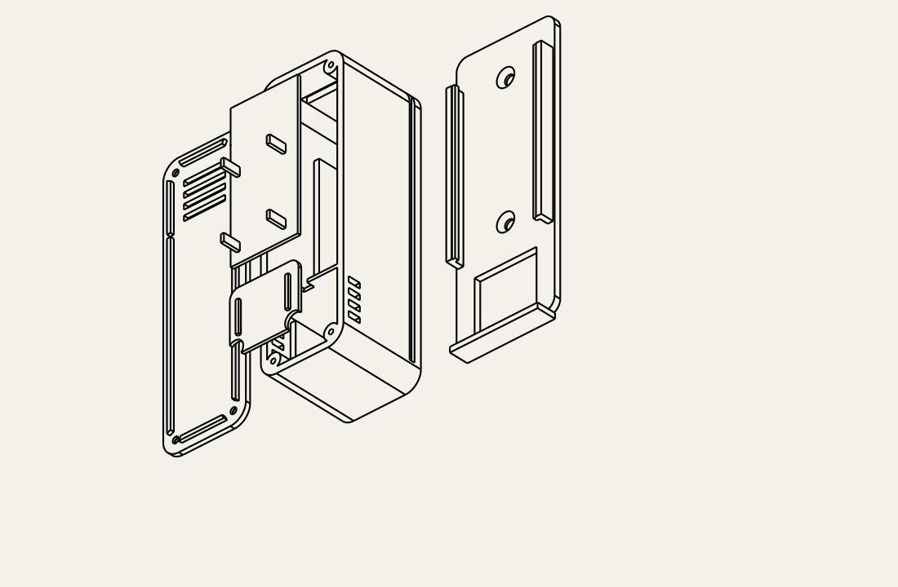

# Stacked transmitter with internal temperature/humidity sensor

Rounded **32 × 102 × 34.8 mm** housing with a vented front, separate internal
sensor pocket, stacked 102050 battery/PCB and slide-on wall cradle.
Fits the nominal 17.78 × 60 mm CC1101 and LoRa carrier outlines in this repo.
It is narrower with a 17% smaller wall footprint than the original side-by-side
concept, but thicker and greater in volume. That earlier version had no sensor bay.



## Print files

Print one each: [base](exports/base.stl), [lid](exports/lid.stl),
[battery deck](exports/battery_deck.stl), [sensor shelf](exports/sensor_shelf.stl),
and [wall cradle](exports/wall_mount.stl). Editable [assembly STEP](exports/assembly.step)
and individual STEP files are supplied. Cradle is 38 × 104 × 7.45 and adds
2.75 behind housing. Corner radius 6; walls 2.4; floor/lid 1.8. All units mm.

Starting settings: PETG, 0.2 layers, 0.4 nozzle, four perimeters, 20% infill.
All STLs have their bed face at Z=0: base floor, lid outer face, deck/shelf
underside, cradle back. No supports intended: wire notch bridges 4 mm and
keeper rails overhang about 1.2 mm. The internal shelves are removable to avoid
trapped supports. Deburr rails and check assembly before installing electronics.

## Sensor best practices

Install vertically: **sensor at bottom, antenna at top**. Electronics are above
sensor, reducing exposure to their rising warm air. A full-height partition
separates bays, with a 4 × 3 wire notch. A removable raised shelf makes the
sensor pocket shallow. Four front slots and four on each side exchange room air
near the sensing element, clear of the wall cradle. The cradle also has a
cutout behind the bay. These measures reduce thermal coupling; they cannot
eliminate electronics or wall bias.

Based on [Sensirion's design guide](https://sensirion.com/media/documents/FC5BED84/662B494D/Sensirion_Humidity_Temperature_Design_Guide.pdf):
small dead volume, ambient openings, a separate sensor compartment and thermal
separation from electronics. No accuracy or response time is claimed without
physical comparison testing.

Use a separate breakout on short, thin flexible wires, components facing front
vents. Assumed maximum PCB is **20 × 18 × 1.6**, placed X=6, Y=7.8, Z=25.2,
with components at most **4 mm above the PCB**. Use low-profile soldered wires
rather than tall headers. Actual Si7021/GY-21 and BME280 breakout sizes vary;
check the sensing element aligns near a slot. BMP280 does not measure humidity.
Retain only the board edges on the tiny seats; keep port exposed and pocket
clear of foam. Do not attach sensor to the main PCB or battery.

Fit sensor shelf on its side ledges. If needed, close the small shelf perimeter
gaps and wire notch with low-emission tape, away from the sensor port. Let
printed parts and adhesives air out before installing the humidity sensor;
avoid uncured sealants and solvent residue. Added filters require response testing.

Mount on an interior wall away from sunlight, radiators, vents, drafts and damp
surfaces. Keep slots clear. Read sensor before radio transmission, use low duty
cycle measurements, disable unnecessary breakout LEDs and leave sensor heaters
off during ordinary ambient measurements. Heated gas sensors need separate
thermal evaluation. This enclosure is for indoor use and is not water sealed.

## Fit and assembly

102050 assumes a nominal **10 × 20 × 50** pouch, not a verified vendor drawing.
Place at X=6, Y=32, Z=1.8. Space under deck is 23.2 wide and 11.2 high with
extra length for wiring. Measure protected cell, wrapping and leads; never
compress pouch. Retain with a small removable adhesive pad within clearance.

Drop battery deck onto ledges at Z=13. It separates solder from the pouch and
supports PCB without resting on battery. Carrier underside Z=21, top Z=22.6:
**6.8 below** to deck and **10.4 above** to lid, or 9 near its locating skirt.
Check actual Pro Mini sockets, radio, solder tails, JST and cable bends. These
are envelope limits, not measured assembly heights. Retain PCB with thin
insulating removable tape at edge seats; carrier has no mounting holes.
Unplug battery and lift out PCB/deck for servicing or programming.

Antenna exits upper slot X=6…25, Z=20…23; route insulated lead from radio pad if
needed. Keep antenna outside and away from cell. Run sensor wires through
partition notch without pinching at lid. Use four **M2 × 8 pan-head plastic
tapping screws**, head diameter at most 4.2, in 1.7 pilots. Start by hand and
do not overtighten.

Cradle uses two 3 mm countersunk wall screws **50 mm apart**, with suitable
wall anchors. Heads must be flush/recessed. Slide case downward from above
until bottom stop. Leave at least 102 above for removal. Gravity retains case;
this is not a locking mount for overhead or vibration use.

## Regenerate and validate

Run from this folder:

```sh
uv venv --python 3.12 .venv
uv pip install --python .venv/bin/python cadquery==2.8.0 trimesh==5.2.0
.venv/bin/python generate.py
.venv/bin/python validate.py
```

Some feature coordinates follow current board layout and need inspection when
changing dimensions. Validation checks watertight positive-volume STL meshes,
assembled part intersections and nominal battery, carrier and sensor PCB fit.
Results: [validation.json](exports/validation.json). Actual component envelopes,
wiring, print fit, retention and sensor response still require physical testing.
