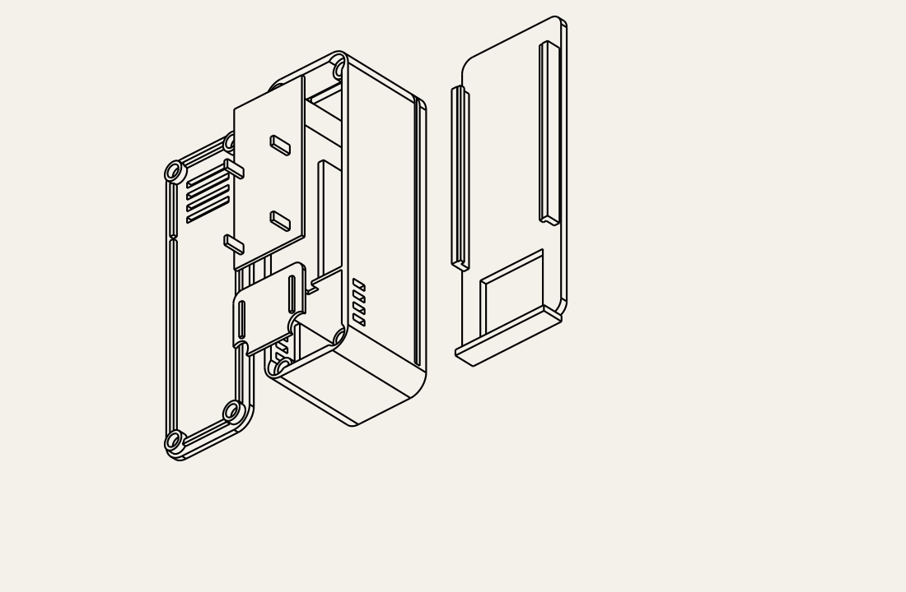

# Magnetic-lid transmitter enclosure

Alternative to [snap-fit](../enclosure_screwless/README.md): a lift-off lid held
by **four pairs of 4 × 2 mm disc magnets**. No screws or flexible latches.
Requires **eight magnets**, glue, and optional adhesive strips for wall mounting.
Existing screw and snap-fit versions remain separate.

Same **32 × 102 × 34.8 mm** housing, stacked 102050 battery/carrier PCB,
ventilated internal temperature/humidity compartment and slide-off wall cradle.
Magnet pockets are hidden on the mating surfaces, leaving the front plain
apart from sensor ventilation. A shallow side recess helps lift the lid.



## Files

Print one each: [base](exports/base.stl), [lid](exports/lid.stl),
[battery deck](exports/battery_deck.stl), [sensor shelf](exports/sensor_shelf.stl),
and [wall cradle](exports/wall_mount.stl).
[Assembled STEP](exports/assembly.step) and individual STEP files are supplied.

Print in supplied orientations: base and cradle backs down, lid outer face
down, shelf/deck undersides down. Starting settings: PETG, 0.2 mm layers,
0.4 mm nozzle, four perimeters and 20% infill. No supports intended. Magnet
pockets open upward in the print orientations. Pocket diameter **4.2**, depth
**2.2**; these are glue clearances, not an interference fit. Test your magnets
and printer tolerance before applying glue. PLA can also be prototyped since
there are no flexible latch arms.

## Installing magnets

Use eight axially magnetized **4 mm diameter × 2 mm thick discs**. Clean printed
pockets and dry-fit the lid. Seat magnet faces flush with each pocket opening,
allowing up to 0.2 mm for adhesive beneath them. A temporary nonmagnetic flat
spacer can help hold the desired depth. The nominal gap between opposing faces
is **0.2 mm** when lid is seated. Recessing magnets further increases that gap
and reduces attraction; proud magnets can stop lid from seating properly.

Mark polarity first. Each lid magnet must attract its matching base magnet.
Dry-test all four pairs before bonding. Use a small amount of adhesive suited
to your printed material and magnet coating, keep faces clean, and cure the
parts apart so excess glue cannot bond the lid shut. Finish bonding and air
out the enclosure before installing the humidity sensor. Avoid uncured adhesive
or solvent fumes near the sensing port. Magnets must be securely bonded so
they cannot become loose inside the electronics or near the battery.

The locating skirt positions the lid; magnets provide retention. Lift at the
side seam recess to open. Pull force depends on actual magnet grade, gaps,
coating and print dimensions and is **not physically verified**. This is an
indoor service lid, not a locking closure for impacts, overhead mounting or
vibration. Do not assume compatibility with magnetically sensitive sensors
such as reed switches or magnetometers without testing their placement.

## Electronics and wall mounting

Follow [the original electronics and sensor assembly guidance](../enclosure/README.md):
sensor at bottom with components facing front vents, antenna up, separate
sensor bay and thin flexible sensor leads. Sensor PCB assumes at most
**20 × 18 × 1.6**, with components up to **4 mm** tall above the PCB. Use low
profile wires. The shelf has clearance cutouts around magnet posts.

102050 assumes nominal **10 × 20 × 50**. Measure actual protected cell and
wrapped ends. PCB seats, battery protection deck, sensor air slots and thermal
partition retain the same coordinates as the other variants. Verify headers,
connectors and wire bends. Keep the sensing element clear of adhesive, foam
and hot components. Actual fit and temperature response require testing.

The cradle has a flat back for two adhesive strips up to **20 × 25** behind
electronics, at approximately housing Y=32…57 and Y=65…90. Keep the sensor
cutout and rails clear. Follow the strip maker's wall preparation, load and
cure instructions; adhesive strength is untested. Cradle is **38 × 104 × 7.45**
and adds 2.75 behind housing plus tape thickness. Slide case down to bottom
stop and leave 102 above for removal. Mount vertically on an indoor wall away
from direct sun, heat and drafts. The case is retained in the cradle by gravity.

## Regeneration and validation

Run in this folder:

```sh
uv venv --python 3.12 .venv
uv pip install --python .venv/bin/python cadquery==2.8.0 trimesh==5.2.0
.venv/bin/python generate.py
.venv/bin/python validate.py
```

Generator checks single valid solids before STL/STEP export. Validation checks
watertight positive-volume meshes, assembled part collisions, nominal cell,
carrier and sensor PCB clearance, magnet clearance and free upward lid removal.
[Validation results](exports/validation.json) establish geometry only; magnetic
holding force, adhesive bond, print fit and sensor accuracy need physical tests.
