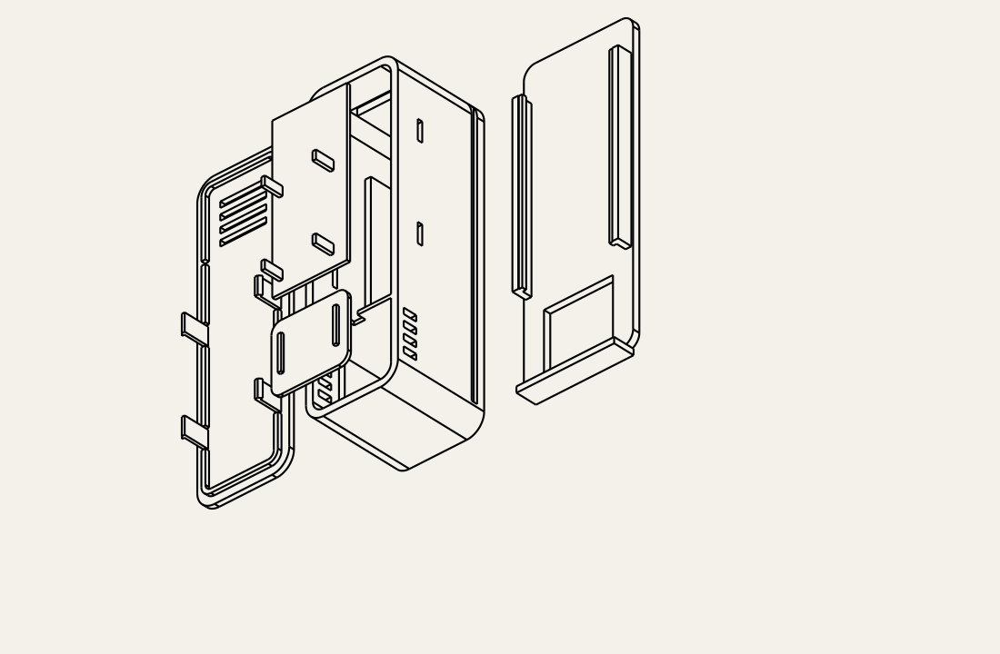

# Screwless transmitter enclosure

Separate version of [the screw-fastened enclosure](../enclosure/README.md).
Same **32 × 102 × 34.8 mm** stacked battery/PCB housing and internal ventilated
temperature/humidity pocket. Four flexible snap hooks replace lid screws and
posts. Two release windows per long side allow servicing. The slide-off wall
cradle has a flat back for adhesive strips, with no screw holes.



## Print files

Print one each: [base](exports/base.stl), [snap lid](exports/lid.stl),
[battery deck](exports/battery_deck.stl), [sensor shelf](exports/sensor_shelf.stl),
[wall cradle](exports/wall_mount.stl). [Assembly STEP](exports/assembly.step)
and individual editable STEP files are included.

Use **PETG** as a starting material, 0.2 mm layers, 0.4 mm nozzle, four
perimeters, 20% infill. Print in supplied orientations, lid outside face down.
Clips are 1 mm thick × 6 mm wide, 9 mm long, with 0.45 mm interference at
the inner housing wall and a sloped insertion ramp. No supports intended.
The printed hooks' layer orientation and your material affect durability;
snap force and cycle life have not been physically tested. PLA is less suitable
for repeated flexing. Deburr mating faces before assembly.

## Assembly and opening

Install sensor shelf, cell, battery deck and PCB as described in the
[original assembly instructions](../enclosure/README.md). Sensor bay stays at
the bottom, antenna at the top. The separate shelves remain removable.
Do not obstruct the front or side sensor vents.

Align lid with vents over sensor pocket. Press gently at each latch until all
four hooks seat in the side windows. Check the lid sits flush. If force is
excessive, stop and adjust `HOOK_PROJECTION` or printer dimensional calibration.
Do not force a tight lid over a loaded battery compartment.

To open, slide case off wall cradle. Through each side window, use a thin blunt
plastic tool to push the hook inward approximately 0.5 mm while lifting that
lid edge slightly. Release sequentially, using a thin plastic shim to keep
released edges from clicking back. Avoid metal tools near battery/wires.
This is a screwless, tool-assisted service lid; the hooks are not external
finger buttons. Do not pull on unreleased hooks.

## Wall attachment without screws

Apply two adhesive strips up to **20 × 25 mm** to the flat cradle back behind
the electronics area, approximately Y=32…57 and Y=65…90 in assembled housing
coordinates. Keep sensor cutout and sliding rails clear; leave stretch-release
tabs accessible if your strips use them. Follow the adhesive maker's surface,
load and cure instructions for the actual wall. Adhesive is not supplied and
bond strength is untested. Cradle adds 2.75 mm behind housing, plus tape thickness.

Mount vertically, sensor down. Slide case downward into cradle until stopped;
leave at least 102 mm above it for removal. Gravity retains case. Use indoors
on a suitable clean wall, away from heat, sunlight and drafts. For unsuitable
wall surfaces, use the screw-mounted original instead.

## Fit and verification

Sensor PCB assumption: at most **20 × 18 × 1.6 mm**, components up to 4 mm
above PCB, low-profile flexible leads. Battery assumes **10 × 20 × 50 mm**;
measure protected cell and wrapping. Actual header heights, connector bends,
sensor position, print fit and ambient measurement accuracy need checking.
Thermal partition, front/side ventilation, small sensor contacts and protected
battery stack follow the original design; its sensor placement guidance applies.

Run in this directory:

```sh
uv venv --python 3.12 .venv
uv pip install --python .venv/bin/python cadquery==2.8.0 trimesh==5.2.0
.venv/bin/python generate.py
.venv/bin/python validate.py
```

Validation checks one solid per generated part, watertight positive-volume
meshes, zero seated part collisions, and nominal cell/carrier/sensor envelopes.
It also verifies the hooks catch the wall when lifting the unreleased lid by
0.6 mm. [Results](exports/validation.json) are geometric checks, not a strength,
flexure, adhesive or physical print test. The original version is unchanged.
